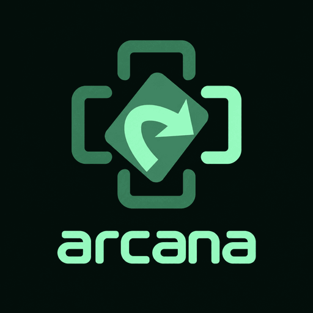

# Arcana Table

Arcana Table is a mobile-first digital tabletop for multiplayer **Magic: The Gathering**, designed with Commander games in mind.

Players can create or join a room, bring in a deck, and manage their game from a shared table on their phones.

## What it does

- Provides multiplayer rooms for local Wi-Fi or internet games.
- Includes a lobby for joining players and getting the table ready.
- Organizes each player's battlefield and game information in a touch-friendly view.
- Provides controls for common game actions and turn flow.

Arcana Table is under active development. Rules automation and individual card interactions continue to evolve; use the table as a companion to your group’s normal rules checks.

## Project site

Visit the [Arcana Table project page](https://aarmou.github.io/arcana_table/).

## Source code

The Android app and internet room service source are in [android/](android/), with ongoing app integration developed and validated on dedicated branches. **Do not treat the `main` branch's historical Android snapshot as the current Build 138 release source.** The latest owner-directed release candidate integrates six feature PRs in an isolated CI runner; see [Build 138 production-package evidence](https://github.com/AARMOU/arcana_table/actions/runs/40512660878) and [PR #309](https://github.com/AARMOU/arcana_table/pull/309).

**Build 138 as of October 27, 2026:** The `com.arcanatable` Google Play release AAB (versionCode 138) passed compilation and validation and was signed using the existing Play upload key. Google Play Console acceptance and rollout are **not verified**. The unsigned CI artifact is not a signed installable release, and the signed bundle is not available from the public repository.

Features in the candidate include offline Argentum-powered games with AI, categorized Commander premades, enabled import/editor tools, 20 interactive tutorial chapters with practice, and an early Wi-Fi/internet multiplayer preview with a four-seat lobby, room chat and private hands. These features still need physical-device acceptance. Standalone developer test-scenario boards are **debug-only**, not included in the Play release.

Open the android folder in Android Studio to build the app. See [android/README.md](android/README.md) for features, requirements, and build notes. The internet room service is in [android/cloud-room/](android/cloud-room/).

## Project page and Pages deployment

- [index.html](index.html) — responsive project site with Build 138 features, milestones since Build 121, testing limits, and screenshots clearly labeled as earlier captures.
- [closed-testing.html](closed-testing.html) — invitation-request information aligned to the Build 138 candidate.
- [.github/workflows/pages.yml](.github/workflows/pages.yml) — publishes the landing page, closed-testing information, privacy policy, static assets, and control dashboard when approved site changes land on `main`.

Site changes are staged in a separate PR before merging to `main`; the Pages workflow does not deploy a development branch automatically. The Android source is not included in the published Pages artifact.

## Disclaimer

Arcana Table is an independent fan-made project and is not affiliated with, endorsed, sponsored, or specifically approved by Wizards of the Coast. Magic: The Gathering is a trademark of Wizards of the Coast LLC.
